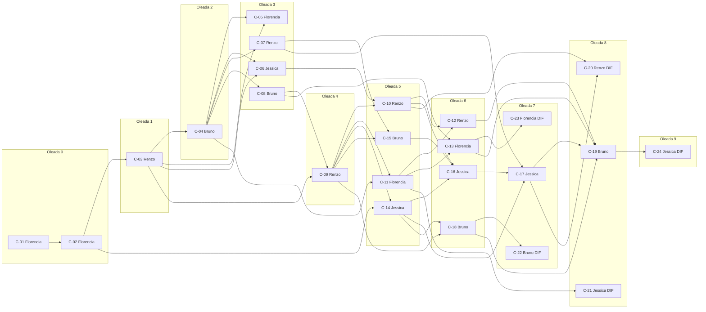

# Plan de trabajo del equipo — DentaFlow

> Acordado el 2026-11-24. Líder y administradora del repositorio: **Florencia**. Integrantes: **Florencia, Bruno, Jessica y Renzo**.
> Fuente de verdad del orden y las dependencias: [CHANGES.md](../CHANGES.md) (sección "Tabla de changes"). Si este documento y `CHANGES.md` difieren, manda `CHANGES.md`.

## 1. Stack con el que se trabaja

Java 21 + Spring Boot 3 (Maven) · **MySQL 8 nativo** + Flyway · tests de backend sobre **H2 en memoria `MODE=MySQL;DATABASE_TO_LOWER=TRUE`** · React + Vite + TypeScript · **sin Docker, docker-compose ni Testcontainers**. El detalle vigente está en [openspec/config.yaml](../openspec/config.yaml).

> ⚠️ La KB (DD-08), las notas de stack de algunas fichas de `CHANGES.md` y las reglas duras de `CLAUDE.md` todavía describen PostgreSQL + Testcontainers. **C-01** registra la decisión nueva y regenera `CLAUDE.md`. Hasta que C-01 esté mergeado, ningún agente debe aplicar las reglas de PostgreSQL/Testcontainers/H2 de `CLAUDE.md`.

Consecuencias técnicas que todos deben respetar:

- **Anti-solapamiento sin `EXCLUDE USING gist`**: la verificación vive en la transacción de creación/cambio de turno con bloqueo pesimista (`SELECT ... FOR UPDATE` / `@Lock(PESSIMISTIC_WRITE)`) sobre **el profesional y el sillón** (RN-TU-01/02 exigen ambos), siempre en el mismo orden (primero profesional, después sillón) para evitar deadlocks. Lo diseña Renzo en C-09 y lo reusan C-10, C-12, C-16, C-17 y C-20.
- **H2 no es MySQL**: H2 `MODE=MySQL` no reproduce fielmente el bloqueo de filas de InnoDB. Los tests de concurrencia de C-09/C-16/C-19 se corren además contra un MySQL 8 local (perfil `it-mysql`, opcional en CI) antes de aprobar el PR.
- **Horas**: columnas `DATETIME(6)` guardadas en UTC y mapeadas a `Instant`/`OffsetDateTime`; se interpretan en `America/Argentina/Buenos_Aires` (SU-09). Nunca `LocalDateTime` ni la hora del servidor.

## 2. Asignación por integrante

| Integrante | Área | Changes (en orden) | Puntos |
|------------|------|--------------------|--------|
| **Florencia** (líder) | Base del proyecto y frontend de paneles internos | C-01 → C-02 → C-05 → C-11 → C-13 → C-23 [DIF] | 12 |
| **Bruno** | Plataforma, seguridad, auditoría y tareas programadas | C-04 → C-08 → C-15 → C-18 → C-22 [DIF] → C-19 | 12 |
| **Jessica** | Configuración de agenda, notificaciones y paciente | C-06 → C-14 → C-16 → C-17 → C-21 [DIF] → C-24 [DIF] | 11 |
| **Renzo** | Núcleo de turnos (backend) | C-03 → C-07 → C-09 → C-10 → C-12 → C-20 [DIF] | 13 |

S = 1, M = 2, L = 3 puntos. [DIF] = diferenciador opcional: si el plazo (PA-01) no alcanza, se omite y su responsable apoya el cierre del MVP.

**Revisión**: Florencia aprueba **todos** los PR. Los PR de Florencia (C-01, C-02, C-05, C-11, C-13, C-23) los aprueba **Bruno**, porque GitHub no deja aprobar el PR propio. Cualquier integrante puede dejar una revisión de apoyo; para los CRITICOS (C-03, C-04, C-08, C-09, C-10, C-12) se recomienda una segunda revisión de alguien que consuma ese código.

## 3. Matriz de oleadas

Un change arranca cuando **todos** sus "Depende de" están mergeados en `main`. La oleada es la ventana prevista: no hace falta esperar a que termine toda la oleada anterior. Máximo **1 change activo por persona**.

| Oleada | Arranca cuando | Florencia | Bruno | Jessica | Renzo |
|--------|----------------|-----------|-------|---------|-------|
| 0 | — | **C-01** → **C-02** | apoyo GitHub/CI (protección de `main`, Actions) | preparación | preparación |
| 1 | C-02 ✓ | revisa C-03 | preparación | preparación | **C-03** |
| 2 | C-03 ✓ | revisa C-04 | **C-04** | preparación | preparación |
| 3 | C-04 ✓ (fork ×4) | **C-05** | **C-08** | **C-06** | **C-07** |
| 4 | C-08 ✓ | revisa C-09 | preparación | preparación | **C-09** |
| 5 | C-09 ✓ (fork ×4) | **C-11** | **C-15** | **C-14** | **C-10** |
| 6 | C-10, C-11, C-14, C-15 ✓ (fork ×4) | **C-13** | **C-18** | **C-16** | **C-12** |
| 7 | C-13, C-16, C-18 ✓ (fork ×3) | **C-23** [DIF] | **C-22** [DIF] | **C-17** | revisa C-17 / prepara E2E |
| 8 | C-17 ✓ (+ C-12, C-13, C-18) | revisión final | **C-19** | **C-21** [DIF] | **C-20** [DIF] |
| 9 | C-19 ✓ | — | — | **C-24** [DIF] | — |

Las oleadas 0, 1, 2 y 4 tienen un solo change porque el bloqueo es real: C-01 → C-02 → C-03 → C-04 es una cadena, y C-09 necesita C-08. No se fuerza paralelismo ahí.

**Preparación** (sin código de producción, sin rama de change abierta):

| Oleada | Bruno | Jessica | Renzo |
|--------|-------|---------|-------|
| 0 | Protección de `main`, CI | Flujo de reserva mobile-first (Flujo 1) y textos de emails | Lectura de KB 04/05; boceto de entidades de C-03 y C-09 |
| 1 | Decisión cookie vs JWT para C-04 (front y API en dominios distintos) | Reglas de horarios y bloqueos (C-06, PA-11) | — |
| 2 | — | Plantillas de email y elección Brevo/Resend (C-14) | Diseño del bloqueo pesimista profesional + sillón (C-09) |
| 4 | Diseño de C-15 (aviso de privacidad) | Diseño de enlaces con token (C-14) | — |

### Mapa de dependencias entre oleadas



Camino crítico: `C-01 → C-02 → C-03 → C-04 → C-08 → C-09 → C-10 → C-16 → C-17 → C-19`.

## 4. Protocolo obligatorio (Git + OpenSpec)

Vale para los 4 integrantes y para cada change.

1. **Verificar que se puede arrancar**: todos los "Depende de" del change están `[x]` en `CHANGES.md` y mergeados en `main`; las PA de "Bloqueado por" están resueltas o se parametrizan como dice la ficha.
2. **Crear la rama desde `main` actualizado**:
   ```bash
   git switch main
   git pull origin main
   git switch -c feat/C-XX-nombre-corto
   ```
3. **Proponer con OpenSpec** (en Claude Code): `/openspec-propose C-XX nombre-corto`. Genera `proposal.md`, delta `specs/`, `design.md` y `tasks.md` en `openspec/changes/c-xx-nombre-corto/`. Revisar que:
   - el DDL sea compatible con MySQL 8 (`BIGINT AUTO_INCREMENT`, `DATETIME(6)`, InnoDB) y con H2 `MODE=MySQL`;
   - ninguna tarea requiera Docker ni Testcontainers;
   - se respeten los "Leer antes" de la ficha.
   Commit: `docs: propuesta openspec de C-XX`. Push y abrir el PR como **borrador** (draft) para que Florencia vea el alcance temprano.
4. **Implementar con TDD estricto**: `/openspec-apply-change c-xx-nombre-corto`. Primero el test que falla, después el código mínimo, después el refactor. Commits chicos en Conventional Commits en castellano (`feat:`, `fix:`, `test:`, `refactor:`, `docs:`, `chore:`), sin línea `Co-Authored-By` de asistentes de IA.
5. **Antes de pedir revisión**:
   ```bash
   git fetch origin
   git rebase origin/main      # resolver conflictos en la rama propia, nunca en main
   cd backend && ./mvnw verify
   cd ../frontend && npm run lint && npm test
   git push --force-with-lease
   ```
   Pasar el PR a "Ready for review" con: change, US/RN cubiertas, evidencia de tests y capturas si hay UI.
6. **Revisión y aprobación**: Florencia (o Bruno para los PR de Florencia). CI en verde y 1 aprobación son obligatorios para mergear.
7. **Archivar y mergear**: con el PR aprobado, en la misma rama:
   - `/openspec-archive-change c-xx-nombre-corto` (mueve el change a `openspec/changes/archive/` y sincroniza las specs);
   - marcar `[x]` en la ficha y en la fila del change en `CHANGES.md` (solo tu fila);
   - commit `docs: archivar C-XX`, push y **squash merge** a `main`; borrar la rama.
8. **Avisar al equipo** qué changes quedan desbloqueados.

### Reglas para evitar conflictos de merge

- **Migraciones Flyway con versión por change**: el change C-NN usa `V0NN_<n>__descripcion.sql` (por ejemplo, C-09 → `V009_1__turno_y_paciente.sql`). Así dos changes paralelos nunca chocan de versión. Reemplaza la numeración "Migración 001/002/…" de las fichas. En el perfil de desarrollo local activar `spring.flyway.out-of-order=true`, porque los changes de una misma oleada pueden mergearse en otro orden.
- **Archivos compartidos** (`pom.xml`, `package.json`, configuración de Spring Security, router del frontend, seed): cambios mínimos y aditivos, en un commit aparte, y rebase antes del PR. La configuración de seguridad base la define Bruno en C-04; los demás agregan sus reglas de endpoint sin reescribirla.
- **`CHANGES.md`**: cada uno edita solo la ficha y la fila de su change.
- **Ramas cortas**: un change por rama, sin mezclar changes; si el PR crece demasiado, dividir tareas, no changes.

### Configuración del repositorio (Florencia y Bruno, en C-01/C-02)

- Florencia con rol **Admin** en el repositorio.
- Regla de protección de `main`: PR obligatorio, 1 aprobación, checks de CI obligatorios, rama actualizada antes de mergear, sin push directo ni force-push, solo squash merge.
- `CODEOWNERS` con Florencia como dueña por defecto (`* @<usuario-de-Florencia>`) y Bruno como dueño alternativo, para que GitHub pida la revisión automáticamente.

## 5. Primer change de cada integrante

**Florencia — C-01 y luego C-02 (Oleada 0, arranca ya)**

```bash
git switch main && git pull origin main
git switch -c feat/C-01-decision-stack-y-plazo
```
Luego en Claude Code: `/openspec-propose C-01 decision-stack-y-plazo`

Al mergear C-01:

```bash
git switch main && git pull origin main
git switch -c feat/C-02-scaffolding-proyecto
```
Luego: `/openspec-propose C-02 scaffolding-proyecto`

**Renzo — C-03 (Oleada 1, cuando C-02 esté mergeado)**

```bash
git switch main && git pull origin main
git switch -c feat/C-03-modelo-recursos-consultorio
```
Luego: `/openspec-propose C-03 modelo-recursos-consultorio`

**Bruno — C-04 (Oleada 2, cuando C-03 esté mergeado)**

```bash
git switch main && git pull origin main
git switch -c feat/C-04-auth-usuarios-roles
```
Luego: `/openspec-propose C-04 auth-usuarios-roles`

**Jessica — C-06 (Oleada 3, cuando C-04 esté mergeado)**

```bash
git switch main && git pull origin main
git switch -c feat/C-06-horarios-y-bloqueos
```
Luego: `/openspec-propose C-06 horarios-y-bloqueos`
