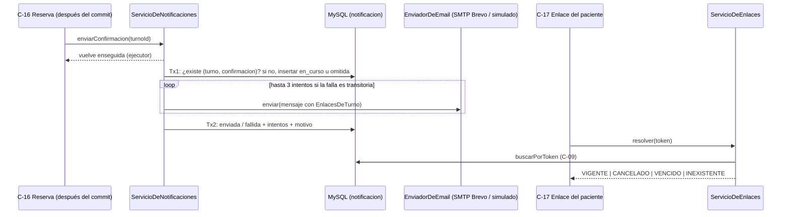

# Design — C-14 `email-transaccional-y-enlaces`

## Context

- **Gobernanza ALTA** (datos personales en el canal de notificación): este diseño se revisa y aprueba (Florencia) antes de escribir código.
- **Ya en `main`**: C-09 entrega `turno.token_acceso` (256 bits, Base64 URL, 43 caracteres, `UNIQUE`, guardado en claro a propósito para C-14 y C-18, design D9/Q1 de C-09), `TurnoRepositorio.buscarPorToken` (rechaza formatos inválidos sin consultar), `TurnoCreado(turno, tokenAcceso)` y la máquina de estados. C-15 entrega `Paciente.puedeRecibirEmails()`. C-04 deja `/api/publico/**` público y CORS con `APP_BASE_URL`.
- **No hay** `spring-boot-starter-mail` en `pom.xml` ni configuración de correo en `application.yml`.
- Migraciones existentes: `V003_1`, `V004_1`, `V007_1`, `V008_1`, `V009_1`, `V009_2`, `V015_1`. C-14 usa `V014_1` (`docs/plan-trabajo-equipo.md`; la "Migración 005" de la ficha queda reemplazada). Con `out-of-order=true` en desarrollo, `V014_1` corre aunque `V015_1` ya esté aplicada.
- **Consumidores ya diseñados**: C-18 (design D1) espera `notificacion` con `turno_id`, `tipo`, `canal`, `estado` (`en_curso|enviada|fallida|omitida`), `intentos`, `enviada_en`, `actualizada_en`, `UNIQUE (turno_id, tipo)`, un puerto `EnviadorDeEmail` y `EnlacesDeTurno.confirmar(turno)` / `.cancelar(turno)`. C-19 (design) espera leer los enlaces del adaptador simulado en los E2E.
- Hoy es el día de la entrega (2026-11-26, 12:00, DD-10): el alcance se limita a lo que C-16 y C-17 necesitan; lo demás queda como punto de extensión.

## Goals / Non-Goals

**Goals**
- Email de confirmación de reserva con los tres enlaces, enviado sin bloquear ni revertir la reserva.
- Registro del estado de cada envío, con reintento ante fallas transitorias.
- Enlaces armados con el token de C-09 y resolución del token a `VIGENTE|CANCELADO|VENCIDO|INEXISTENTE`.
- Dominio desacoplado del proveedor; tests sin servidor de correo.
- Contrato de `notificacion` que C-18 pueda usar sin ALTER.

**Non-Goals**
- Endpoints públicos y pantallas de confirmar/cancelar/reprogramar (C-17).
- Selección y envío de recordatorios, cron y reintentos diferidos entre reinicios (C-18).
- Segundo aviso y alerta a recepción (RN-NO-03), WhatsApp (RN-NO-04), listado de fallidas para recepción (C-11/C-12).
- Motor de plantillas (Thymeleaf u otro): no se agrega dependencia.

## Decisions

### D1. Proveedor: Brevo por SMTP
- **Brevo** (SMTP relay `smtp-relay.brevo.com:587`, STARTTLS, plan gratuito con 300 emails/día). Solo pide verificar el remitente; alcanza para la demo y para el despliegue de C-19.
- Alternativa con las mismas variables: **Gmail con contraseña de aplicación** (`smtp.gmail.com:587`), útil si Brevo demora la verificación.
- **Resend descartado**: sin dominio propio verificado solo permite enviar a la dirección de la cuenta, y no tenemos dominio para la demo.
- El código solo conoce SMTP genérico (Spring Mail); cambiar de proveedor es cambiar variables.

### D2. Modelo y migración `V014_1__crear_notificacion.sql`
```sql
CREATE TABLE notificacion (
    id             BIGINT AUTO_INCREMENT PRIMARY KEY,
    turno_id       BIGINT      NOT NULL,
    tipo           VARCHAR(20) NOT NULL,
    canal          VARCHAR(10) NOT NULL,
    estado         VARCHAR(10) NOT NULL,
    intentos       INT         NOT NULL DEFAULT 0,
    motivo_fallo   VARCHAR(20) NULL,
    creada_en      DATETIME(6) NOT NULL,
    actualizada_en DATETIME(6) NOT NULL,
    enviada_en     DATETIME(6) NULL,
    CONSTRAINT uk_notificacion_turno_tipo UNIQUE (turno_id, tipo),
    CONSTRAINT ck_notificacion_tipo   CHECK (tipo IN ('confirmacion', 'recordatorio')),
    CONSTRAINT ck_notificacion_canal  CHECK (canal IN ('email')),
    CONSTRAINT ck_notificacion_estado CHECK (estado IN ('en_curso', 'enviada', 'fallida', 'omitida')),
    CONSTRAINT ck_notificacion_intentos CHECK (intentos >= 0),
    CONSTRAINT ck_notificacion_motivo CHECK (motivo_fallo IS NULL
        OR motivo_fallo IN ('conexion', 'autenticacion', 'destinatario', 'desconocido')),
    CONSTRAINT ck_notificacion_enviada CHECK (
        (estado = 'enviada' AND enviada_en IS NOT NULL) OR (estado <> 'enviada' AND enviada_en IS NULL)),
    CONSTRAINT ck_notificacion_fallida CHECK (
        (estado = 'fallida' AND motivo_fallo IS NOT NULL) OR (estado <> 'fallida' AND motivo_fallo IS NULL)),
    CONSTRAINT fk_notificacion_turno FOREIGN KEY (turno_id) REFERENCES turno (id)
) ENGINE=InnoDB;
-- C-18 busca fallidas o en_curso vencidas por estado y antigüedad.
CREATE INDEX ix_notificacion_estado_actualizada ON notificacion (estado, actualizada_en);
```
- La clave única `(turno_id, tipo)` cubre la FK de `turno_id` (prefijo izquierdo), así que no hace falta otro índice.
- **Desvío de `04_modelo_de_datos.md` §Notificacion**: la KB lista el tipo `reintento`. Con `UNIQUE (turno_id, tipo)` (pedido por C-18 para la idempotencia) un reintento no es otra fila sino `intentos + 1` sobre la misma. Al archivar se actualiza la KB (tarea 9.3).
- **Reprogramación (C-17)**: si C-17 decide reenviar un email al reprogramar, agrega el tipo `reprogramacion` en su propia migración; `confirmacion` no se reenvía.
- `motivo_fallo` es una categoría, nunca el texto del proveedor (que puede repetir la dirección).

### D3. Dominio `dominio/notificaciones/` (Java puro)
- `Notificacion`: `nueva(turnoId, tipo, ahora)` nace `en_curso` con 0 intentos; `registrarIntento(ahora)`, `marcarEnviada(ahora)`, `marcarFallida(motivo, ahora)`, `omitir(ahora)`. Las transiciones inválidas (p. ej. volver de `enviada`) lanzan `OperacionNoPermitidaException`.
- Enums `TipoNotificacion`, `CanalNotificacion`, `EstadoNotificacion`, `MotivoFallo` con código en minúscula (conversores JPA como `ConversorEstadoTurno`).
- `PoliticaDeReintento`: máximo 3 intentos; `debeReintentar(intentos, motivo)` es verdadero solo para `conexion` o `desconocido` con menos de 3 intentos.
- Puertos: `NotificacionRepositorio` (`guardar`, `buscarPorTurnoYTipo`), `EnviadorDeEmail.enviar(MensajeEmail)` que lanza `FallaDeEnvio(motivo)`.
- `MensajeEmail(destinatario, asunto, textoPlano, html)` con `toString` que no imprime destinatario ni cuerpo.
- `SituacionDeEnlace` y la regla `SituacionDeEnlace.de(Turno, Instant ahora)` (ver D6).

### D4. Infraestructura `infraestructura/email/`
- `EnviadorDeEmailSmtp` (`@ConditionalOnProperty(app.mail.modo=smtp)`): `JavaMailSender` con `MimeMessageHelper` multiparte (texto + HTML, UTF-8), remitente `app.mail.from`. Traduce excepciones a `MotivoFallo`:
  - `MailAuthenticationException` → `autenticacion`;
  - `MailSendException` con `SendFailedException` de direcciones inválidas → `destinatario`;
  - `MailSendException` por conexión/timeout o respuesta 4xx → `conexion`;
  - otras → `desconocido`.
- `EnviadorDeEmailSimulado` (`app.mail.modo=simulado`, **valor por defecto**): guarda los últimos 50 mensajes en memoria (lista sincronizada), con `mensajesPara(destinatario)` y `limpiar()`; se puede configurar para fallar N veces con un motivo (para tests). No loguea el contenido. C-19 lo lee para los E2E.
- `PlantillaConfirmacionReserva`: arma asunto, texto plano y HTML a partir de un `DatosDelEmail(destinatario, nombrePaciente, inicio, prestacion, profesional, enlaces)`. Fecha con `ZonaHorariaConsultorio` (`dd/MM/yyyy HH:mm`). HTML con escape propio de `& < > " '`. Sin DNI ni teléfono. **Implementada en `aplicacion/notificaciones/`** (no en `infraestructura/email/`): es Java puro que usa el servicio de aplicación, y así la aplicación no depende de la infraestructura.
- `PropiedadesEmail` (`@ConfigurationProperties("app.mail")`): `modo`, `from`, `nombreRemitente` (por defecto `DentaFlow`); un `from` inválido no arranca. `PropiedadesEnlaces` (`aplicacion/notificaciones`, `app.enlaces.base-url`, que toma `APP_BASE_URL`): URL absoluta http/https, sin barras finales.
- Timeouts SMTP: `spring.mail.properties.mail.smtp.connectiontimeout/timeout/writetimeout = 5000` para que un intento no cuelgue el hilo.

### D5. Aplicación `aplicacion/notificaciones/`
- `ServicioDeNotificaciones.enviarConfirmacion(long turnoId)`: punto de entrada para C-16, que lo llama **después del commit** de la reserva.
  1. Delegado a `EjecutorDeEmails` (tipo propio, no un `Executor`, para no reemplazar el ejecutor por defecto de Spring Boot; 2 hilos, cola acotada de 100). Con `app.notificaciones.asincronico=false` (perfil `test`) corre la tarea en un hilo nuevo y espera a que termine: el envío nunca comparte hilo ni transacción con quien llama. Si se llama dentro de una transacción, el envío se registra para después del commit (`TransactionSynchronization.afterCommit`) y no ocurre si se revierte. La request de C-16 no espera al SMTP.
  2. **Transacción corta 1**: si ya existe `(turno, confirmacion)` → no hace nada (idempotente). Si no, lee turno, paciente, prestación y profesional; si `!paciente.puedeRecibirEmails()` guarda `omitida`; si no, guarda `en_curso`. Un `DataIntegrityViolationException` por la clave única (dos llamadas simultáneas) se toma como "ya existe".
  3. **Fuera de transacción**: arma el mensaje y llama a `EnviadorDeEmail` con hasta 3 intentos según `PoliticaDeReintento`, con espera de 1 s y 2 s entre intentos (inyectable para tests: espera nula).
  4. **Transacción corta 2**: guarda intentos y estado final (`enviada` + `enviada_en`, o `fallida` + motivo).
- Ninguna transacción de base queda abierta mientras se habla con el servidor de correo.
- Los turnos se leen con `ServicioDeTurnos.buscarPorId` y `buscarPorToken` (C-09), no con `TurnoRepositorio`: C-14 no depende de la persistencia de turnos y respeta la guarda `UnicaViaDeEscrituraDeTurnosTest`.
- Riesgo aceptado: si el proceso se cae entre 2 y 4 la notificación queda `en_curso`; C-18 ya prevé retomar `en_curso` vencidas. Para la confirmación, en el MVP la recepción ve el turno y puede usar wa.me.
- Logs: `notificacion={id} turno={id} tipo=confirmacion estado=fallida intentos=3 motivo=conexion`. Nunca destinatario, nombre, token ni enlace.

### D6. Enlaces y resolución del token
- `EnlacesDeTurno` (aplicación): `confirmar(Turno)`, `cancelar(Turno)`, `reprogramar(Turno)` y `todos(Turno)` → `<base>/turno/<token>/<accion>`. Usa `turno.tokenAcceso()`: **no** se genera otro token ni se toca `GeneradorDeTokens`. El token está en el *path* (no en query) y es Base64 URL, así que no necesita codificación.
- `ServicioDeEnlaces.resolver(String token)` (solo lectura): usa `ServicioDeTurnos.buscarPorToken` → `TurnoRepositorio.buscarPorToken` de C-09 (que ya rechaza formatos inválidos sin consultar) y `SituacionDeEnlace.de(turno, reloj.instant())`:
  - no encontrado → `INEXISTENTE` (no distingue mal formado de inexistente);
  - `cancelado` → `CANCELADO`;
  - `asistio`, `ausente`, `ausente_con_aviso`, o `ahora >= inicio` → `VENCIDO`;
  - `pendiente` o `confirmado` con `ahora < inicio` → `VIGENTE`.
- Devuelve `ResolucionDeEnlace(situacion, Optional<ResumenTurnoPaciente>)`; el resumen trae inicio, fin, estado, prestación y profesional, sin datos del paciente ni ids internos. No escribe nada (sin historial).
- **"Vencido" no es una columna**: el enlace vence con el turno. Así no hace falta migrar `turno` ni rotar tokens, y la ventana de anticipación mínima (RN-CA-01) la sigue verificando C-17 sobre un turno `VIGENTE`.
- Fuerza bruta: 256 bits de entropía hacen impracticable adivinar; el rate limiting de lo público se evalúa en C-16.
- C-17 debe servir sus páginas con `Referrer-Policy: no-referrer` para que el token no salga a terceros (anotado como contrato).

### D7. Configuración (`application.yml`, `.env.example`, `pom.xml`)
```yaml
app:
  enlaces:
    base-url: ${APP_BASE_URL:http://localhost:5173}
  mail:
    modo: ${APP_MAIL_MODO:simulado}
    from: ${APP_MAIL_FROM:turnos@dentaflow.local}
  notificaciones:
    asincronico: true             # false en el perfil test
    espera-entre-intentos: PT1S   # PT0S en el perfil test; se duplica en el tercer intento
spring:
  mail:
    host: ${SPRING_MAIL_HOST:}
    port: ${SPRING_MAIL_PORT:587}
    username: ${SPRING_MAIL_USERNAME:}
    password: ${SPRING_MAIL_PASSWORD:}
    properties.mail.smtp: { auth: true, starttls.enable: true, connectiontimeout: 5000, timeout: 5000, writetimeout: 5000 }
```
- Validación al arrancar (en `ConfiguracionEmail` y en el constructor de `PropiedadesEmail`, sin clase aparte): con `modo=smtp`, exige `spring.mail.host`; en cualquier modo, `app.mail.from` válido. Falla nombrando la variable, sin imprimir la contraseña.
- Se desactiva el health indicator de mail (`management.health.mail.enabled=false`) para que un SMTP caído no ponga la API en `DOWN` en Render.
- `spring-boot-starter-mail` en `pom.xml` en un commit aparte (archivo compartido).
- `orm/notificaciones.xml` se suma a `spring.jpa.mapping-resources` (cambio aditivo).

### D8. Estrategia de pruebas
- **Unitarias (sin Spring)**: `Notificacion`, `PoliticaDeReintento`, `SituacionDeEnlace`, `EnlacesDeTurno`, `PlantillaConfirmacionReserva`, traducción de excepciones de `EnviadorDeEmailSmtp` (con `JavaMailSender` simulado por Mockito).
- **Base (H2 `MODE=MySQL`)**: restricciones de `V014_1` por SQL directo; además `@Tag("mysql")` del mismo test en `it-mysql` (no es concurrencia, pero confirma el DDL en MySQL 8 real).
- **Integración (`@SpringBootTest`, perfil `test`, `Clock` fijo, adaptador simulado, ejecutor síncrono)**: confirmación enviada, idempotencia, reintentos, falla permanente, paciente anonimizado, turno intacto ante falla, logs sin datos (captura con `OutputCaptureExtension`).
- **Configuración**: `ApplicationContextRunner` para el arranque fallido con `modo=smtp` sin host y con `APP_BASE_URL` relativa.
- Sin Docker, Testcontainers ni servidor SMTP de prueba (GreenMail no se agrega: el adaptador SMTP se prueba con `JavaMailSender` simulado y una vez a mano contra Brevo, con evidencia).



## Risks / Trade-offs

- **Reintentos solo en memoria**: un reinicio entre intentos deja `en_curso` o `fallida` sin nuevo intento automático hasta que C-18 lo retome → aceptado para el corte; la recepción ve el turno y puede usar wa.me.
- **Executor en memoria en Render gratuito**: si el proceso se suspende justo después de responder, el email puede quedar `en_curso` → mismo tratamiento.
- **Brevo puede tardar en verificar el remitente** → alternativa Gmail con las mismas variables; la demo local usa el adaptador simulado.
- **Desvío de la KB** (`reintento` deja de ser tipo) → se documenta y se corrige la KB al archivar.
- **Token en la URL**: puede quedar en el historial del navegador del paciente → aceptado por SU-03; mitigado con `Referrer-Policy` en C-17 y porque el enlace vence con el turno.

## Migration Plan

1. `V014_1` solo crea una tabla nueva: no toca datos existentes; con `out-of-order=true` corre en bases locales que ya tienen `V015_1`.
2. Rollback: no se edita la migración mergeada; si hiciera falta, una migración nueva.
3. Despliegue: cargar `SPRING_MAIL_*`, `APP_MAIL_FROM`, `APP_MAIL_MODO=smtp` y `APP_BASE_URL` en Render (C-19).

## Open Questions

| # | Decisión | Recomendación (aplicada en specs y tareas) | Alternativa |
|---|---|---|---|
| Q1 | Proveedor | Brevo SMTP; Gmail como plan B con las mismas variables (D1) | Resend (requiere dominio verificado) |
| Q2 | Tipo `reintento` de la KB | Contar en `intentos` sobre la misma fila; KB actualizada al archivar (D2) | Fila por reintento (choca con la clave única que pide C-18) |
| Q3 | Qué es "enlace vencido" | El turno ya empezó o tiene asistencia; sin columna nueva (D6) | Columna `token_vence_en` en `turno` (migración sobre tabla de C-09) |
| Q4 | Envío síncrono o asíncrono | Ejecutor propio después del commit, 3 intentos con espera 1 s / 2 s (D5) | Síncrono en la request (la reserva tarda hasta ~15 s si el SMTP no responde) |
| Q5 | Plantilla de recordatorio | Fuera de C-14: C-18 la agrega reutilizando `EnlacesDeTurno` y el estilo de `PlantillaConfirmacionReserva` | Incluirla ya (más alcance el día de entrega) |
| Q6 | Endpoint de desarrollo para leer enlaces (C-19) | Fuera de C-14: el adaptador simulado expone los mensajes; C-19 agrega el endpoint `dev` si lo necesita | Agregar `/api/dev/ultimos-enlaces` en C-14 |
