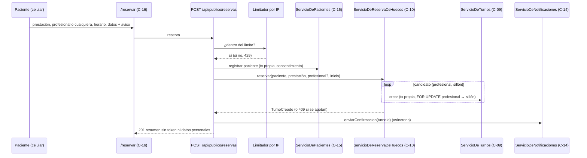

# Design — C-16 `reserva-online-publica`

## Context

- **Gobernanza ALTA** (datos personales en una ruta pública, Ley 25.326): este diseño lo aprueba Florencia antes de escribir código.
- **En `main`**:
  - C-09: `ServicioDeTurnos`, la única vía de escritura de turnos.
  - C-14 (`294c837`): `ServicioDeNotificaciones.enviarConfirmacion(turnoId)`. Se llama después del commit; si se invoca dentro de una transacción, se posterga al commit.
  - C-15: `ServicioDePacientes.registrarDesdeReservaOnline(DatosPaciente)`. Corre en su propia transacción, no pisa el contacto de un DNI existente y exige `consentimientoEn`. También el componente `AvisoPrivacidad` y `esquemaAvisoPrivacidad` (Zod).
  - C-07: parámetros tipados.
  - C-04: `/api/publico/**` público y `GuardasEnControladoresTest`, que exime a `presentacion.publico`; `LimitadorDeIntentosDeIngreso` como patrón.
- **C-10 todavía sin código** (propuesta en `main`). Contrato que usa C-16, tomado de su `design.md`:
  - D6: `ServicioDeReservaDeHuecos.reservar(SolicitudDeReservaDeHueco)` → `TurnoCreado`. No es transaccional: prueba candidatos con una transacción cada uno. Si se agotan, lanza `HuecoNoDisponibleException extends ConflictoException` (409).
  - D7: `GET /api/publico/huecos?prestacionId&profesionalId&desde&hasta` → `[{inicio, fin, profesionalId|null}]` con offset `-03:00`; máximo 14 días.
  - Si al rebasar estos nombres cambian, se ajusta el bloque B antes de escribirlo (tarea 5.1).
- **Modelo del paciente**: `paciente.nombre` y `paciente.apellido` son `NOT NULL` (C-09). La ficha de `CHANGES.md` menciona solo "DNI, teléfono, email": el formulario pide también nombre y apellido (minimización igual cumplida, RN-PR-03).
- **Frontend**: la SPA ya tiene `lib/apiClient`, `lib/erroresApi.leerErrorDeApi`, `components/formulario/Campo` y `features/reserva/AvisoPrivacidad`. No hay ruta pública de reserva.

## Goals / Non-Goals

**Goals**
- Reserva online de punta a punta (Flujo 1) sobre C-10 → C-09, sin reglas duplicadas.
- Ningún solapamiento ni sobreturno online, verificado contra MySQL 8.
- Pantalla usable en 390 px y con teclado (WCAG 2.1 AA).
- Superficie pública mínima: lo justo para reservar, sin datos personales en respuestas, errores ni logs.

**Non-Goals**
- Confirmar, cancelar o reprogramar desde el email (C-17).
- Captcha y verificación previa del email.
- Elegir sillón, sobreturno online, varias reservas en un pedido.

## Decisions

### D1. Capas y archivos
| Capa | Lugar | Clases |
|---|---|---|
| Aplicación | `aplicacion/reservas/` | `ServicioDeReservaOnline` (caso de uso), `SolicitudDeReservaOnline`, `ReservaConfirmada`, `LimitadorDeReservasPorOrigen`, `DemasiadasReservasException` |
| Presentación | `presentacion/publico/` | `CatalogoPublicoController` (prestaciones, profesionales), `ContactoPublicoController`, `ReservasPublicasController`, DTOs `ReservaSolicitud`, `PacienteSolicitud`, `ReservaRespuesta`, `PrestacionPublica`, `ProfesionalPublico`, `ContactoRespuesta` |
| Dominio | `dominio/configuracion/ClaveParametro` (aditivo) | `CONTACTO_CONSULTORIO("contacto-consultorio", …, TEXTO, …, 300, …)` |
| Datos | `db/migration/V016_1__parametro_contacto_consultorio.sql` | `INSERT INTO parametro (clave, valor, provisorio) VALUES ('contacto-consultorio', 'Comunicate con el consultorio por teléfono para coordinar tu turno.', TRUE);` |
| Frontend | `frontend/src/features/reserva/` | `ReservaPage.tsx`, `PasoPrestacion.tsx`, `PasoProfesional.tsx`, `PasoHorario.tsx`, `PasoDatos.tsx`, `ReservaConfirmada.tsx`, `reservaApi.ts`, `esquemasReserva.ts` |

### D2. `ServicioDeReservaOnline.reservar(SolicitudDeReservaOnline)` (no transaccional)
1. Limitador por IP (D5): si se excede, `DemasiadasReservasException` (429) antes de leer o escribir nada.
2. `aceptaAvisoPrivacidad` falso o nulo → `ValidacionDeDominioException(ServicioDePacientes.AVISO_NO_ACEPTADO)` (400). El backend lo verifica aunque Bean Validation ya lo marque.
3. `ServicioDePacientes.registrarDesdeReservaOnline(new DatosPaciente(dni, nombre, apellido, telefono, email, reloj.instant()))` en su propia transacción (C-09 Q11, C-15). Si después la reserva falla, el paciente queda registrado: aceptado por C-09 D8 y con la retención definida en C-15.
4. `ServicioDeReservaDeHuecos.reservar(new SolicitudDeReservaDeHueco(pacienteId, prestacionId, profesionalId|null, inicio, ONLINE, Actor.paciente()))` (C-10 D6; los campos exactos del record no están fijados en C-10 y se confirman en la tarea 5.1). `HuecoNoDisponibleException` se propaga como 409.
5. `ServicioDeNotificaciones.enviarConfirmacion(turnoId)`. Se llama sin transacción abierta y vuelve enseguida (C-14 D5).
6. Devuelve `ReservaConfirmada(inicio, fin, prestacion, profesional, estado)` leída del `TurnoCreado` y de los recursos. Sin token, sillón, ids de paciente ni datos personales.
- Sin `@Transactional` propio: cada paso ya es atómico donde importa, y C-09 exige `READ COMMITTED` si se lo envuelve. Así no se retienen bloqueos mientras se habla con el SMTP.

### D3. API pública
- `GET /api/publico/prestaciones` → `[{id, nombre, duracionMinutos}]`, solo activas, por nombre.
- `GET /api/publico/profesionales?prestacionId=` → `[{id, nombre, apellido}]` (`listarActivosQueRealizan`). Prestación inexistente o inactiva → 404.
- `GET /api/publico/contacto` → `{contacto}`.
- `POST /api/publico/reservas` con cuerpo `{prestacionId, profesionalId?, inicio (OffsetDateTime), paciente: {dni, nombre, apellido, telefono, email}, aceptaAvisoPrivacidad}`:
  - 201 → `{inicio, fin (OffsetDateTime -03:00), prestacion, profesional, estado}`;
  - 400 si el input es inválido o falta el aviso; 404 si la prestación o el profesional no existen; 409 si el horario ya no está; 429 si se pasa el límite.
  - Jackson con `FAIL_ON_UNKNOWN_PROPERTIES=false` (el default de Boot): `sillonId` o `esSobreturno` se ignoran.
- Validación con Bean Validation en los records. El DNI, el teléfono y el email reusan las reglas de dominio de `Paciente` (C-09), que se vuelven a aplicar al registrar. Los mensajes de error no repiten el valor (C-15 D7, `ErroresSinDatosDelInputTest`).
- Respuestas con `Cache-Control: no-store`; OpenAPI con `@Tag("Reserva pública")`.

### D4. Horario y zona
- El frontend muestra días de `hoy` a `hoy + 13` en la zona del consultorio y pide `GET /api/publico/huecos` día por día (`desde = hasta = fecha`).
- El `inicio` elegido se reenvía tal cual llegó (ISO con `-03:00`); el backend lo convierte a `Instant`. El frontend nunca arma horas con la zona del navegador: muestra la hora local tomada del texto ISO.

### D5. Límite anti-abuso por IP
- `LimitadorDeReservasPorOrigen`: ventana fija de 10 minutos y 5 pedidos por IP, en memoria (`ConcurrentHashMap` con limpieza perezosa), con el `Clock` inyectado. Mismo patrón que `LimitadorDeIntentosDeIngreso` (C-04). Cuenta todo pedido de reserva, exitoso o no.
- IP: `request.getRemoteAddr()`, que con `server.forward-headers-strategy: framework` (C-15 D8) ya es la del cliente detrás del proxy de Render. Nunca se loguea la IP.
- 429 `ProblemDetail` "Hiciste demasiados pedidos de reserva. Probá de nuevo en unos minutos." con `Retry-After` en segundos.
- Límite: con varias instancias el límite es por instancia. Aceptado: Render gratuito usa una sola.

### D6. Pantalla `/reservar`
- **Pasos** en una sola página con estado local:
  1. prestación;
  2. profesional, o "Cualquier profesional" como primera opción;
  3. día (botones de 14 días) y horarios (botones `HH:mm`);
  4. formulario con DNI, nombre, apellido, teléfono, email y `AvisoPrivacidad`;
  5. confirmación.
  - Cada paso tiene un encabezado `h2` que recibe el foco al avanzar, y "Volver" mantiene lo elegido.
- **Formulario**: React Hook Form + Zod. El esquema de los datos replica las reglas del backend (DNI de 7 u 8 dígitos, teléfono, email) y suma `esquemaAvisoPrivacidad` de C-15. Errores con `Campo` (etiqueta, `aria-describedby`, `aria-invalid`); al fallar, foco en el primer error.
- **Datos**: hooks de TanStack Query en `reservaApi.ts` sobre `apiClient` (`usePrestacionesPublicas`, `useProfesionalesDe`, `useHuecosDelDia`, `useContacto`, `useReservar`). Nada de `fetch` suelto.
- **Envío**: botón "Reservar turno" deshabilitado mientras `isPending` (un solo pedido).
  - 409: alerta `role="alert"`, invalida y vuelve a pedir los huecos del día, regresa al paso 3 con los datos del formulario conservados.
  - 429: mensaje con el tiempo de espera.
  - 400 con campos: errores en cada campo.
- **Sin huecos**: "No hay horarios disponibles" + contacto (`useContacto`).
- **Mobile-first**: una columna, botones de al menos 44×44 px, Tailwind. Se revisa a 390 px y con teclado (tarea trasladada desde C-15 4.4).
- **Ruta**: `/reservar` en `routes/rutas.tsx`, fuera de `RutaProtegida`, y enlace "Reservar un turno" en `InicioPage`.
- **Textos accesibles estables para C-19**: botones "Reservar turno", "Cualquier profesional", "Volver"; encabezados "Elegí la prestación", "Elegí el profesional", "Elegí día y horario", "Tus datos", "¡Listo! Reservaste tu turno".

### D7. Datos personales
- Las respuestas, los errores y los logs no llevan DNI, nombre, teléfono, email ni IP (spec "Sin datos personales en logs ni errores de la reserva"). Se prueba con `OutputCaptureExtension`, como en C-14 y C-15.
- Paciente existente con otro email: se usa el registrado (C-09 Q2, anti-suplantación). La confirmación dice "Te enviamos un email con los enlaces para confirmar o cancelar", sin mostrar la dirección.

### D8. Estrategia de pruebas (TDD estricto, sin Docker)
| Nivel | Test | Qué cubre |
|---|---|---|
| Unitario | `LimitadorDeReservasPorOrigenTest` | 5 por ventana, 6º rechazado, otra IP libre, ventana que vence (reloj fijo) |
| Unitario Mockito | `ServicioDeReservaOnlineTest` | orden de pasos, aviso no aceptado sin llamar a nadie, 409 sin email, limitador antes de todo |
| HTTP (`@SpringBootTest` + MockMvc) | `CatalogoPublicoControllerTest`, `ContactoPublicoControllerTest` | 200 sin token, campos exactos, 404 |
| HTTP | `ReservasPublicasControllerTest` | 201 de punta a punta (H2, con horario cargado para C-10), 400 por campo sin eco del valor, aviso no aceptado, 409, 429 con `Retry-After`, email en el canal simulado, logs sin datos |
| Datos | `CatalogoDeParametrosConsistenciaTest` (C-07, se actualiza) | cuatro claves y cuatro filas |
| Concurrencia (`@Tag("mysql")`, `it-mysql`) | `ReservaPublicaConcurrenciaMySqlTest` | dos `POST` simultáneos al mismo hueco con 1 profesional + 1 sillón → un 201 y un 409, un solo turno activo; `@RepeatedTest(5)`. Es el test que pide C-19 D7 |
| Frontend (Vitest + Testing Library) | `esquemasReserva.test.ts`, `reservaApi.test.tsx`, `ReservaPage.test.tsx` | validaciones, hooks con la API simulada (`test/apiSimulada`), flujo completo, 409 que vuelve a horarios con datos conservados, sin huecos con contacto, doble toque, foco en el primer error |

## Risks / Trade-offs

- **C-10 no implementado** → el bloque B depende de él. Mitigación: el bloque A avanza ya, y el contrato de C-10 queda verificado en la tarea 5.1 antes de escribir el bloque B. Si C-10 no llega al corte, C-16 tampoco puede reservar (camino crítico; prioridad C-09 + C-10 según `CLAUDE.md`).
- **Paciente registrado aunque falle la reserva** → aceptado (C-09 D8); retención según C-15.
- **Límite en memoria** → se pierde al reiniciar y es por instancia; suficiente para el MVP en una instancia.
- **Email al registrado y no al tipeado** (paciente existente) → protege contra la suplantación; el paciente que cambió de email lo actualiza la recepción.
- **Parámetro compartido con C-18**, que también agrega una clave al catálogo → cada uno usa su migración (`V016_1`, `V018_1`). El test de consistencia del catálogo se resuelve al rebasar el que llegue segundo.

## Migration Plan

1. `V016_1` solo inserta una fila en `parametro`; con `out-of-order=true` corre en bases locales que ya tienen `V014_1`/`V015_1`.
2. Rollback: una migración nueva que borre la fila (nunca se edita la mergeada).
3. Despliegue: sin variables nuevas. El administrador reemplaza el contacto provisorio desde la pantalla de parámetros.

## Open Questions

| # | Decisión | Recomendación (aplicada en specs y tareas) | Alternativa |
|---|---|---|---|
| Q1 | Contacto del consultorio para "sin huecos" | Parámetro `contacto-consultorio` editable + `GET /api/publico/contacto` (D1) | Texto fijo en el frontend (no editable sin deploy) |
| Q2 | Datos del paciente en el formulario | DNI, nombre, apellido, teléfono y email (el modelo exige nombre y apellido) | Solo DNI, teléfono y email (requiere migrar `paciente` y tocar C-09) |
| Q3 | Anti-abuso | Límite por IP 5/10 min en memoria, sin captcha (D5) | Captcha (dependencia externa y fricción en celular) |
| Q4 | Qué devuelve el 201 | Resumen sin token (el token solo viaja por email, que prueba que la dirección es del paciente) | Devolver el token para gestionar el turno al instante |
| Q5 | Rango de días ofrecido | 14 días (máximo de C-10), consulta por día | Calendario mensual (más pedidos y más superficie pública) |
| Q6 | Arranque antes de C-10 | Bloque A ahora; bloque B cuando C-10 esté en `main` | Esperar a C-10 para todo |

## UI Mockups

Design system revision: — (sin sistema de diseño)
Decision: no (project policy) — `visual_design.mode: off` en `.active-orchestrator-state.json` y `Mode: off` en `design-system/README.md` (2026-11-26).
